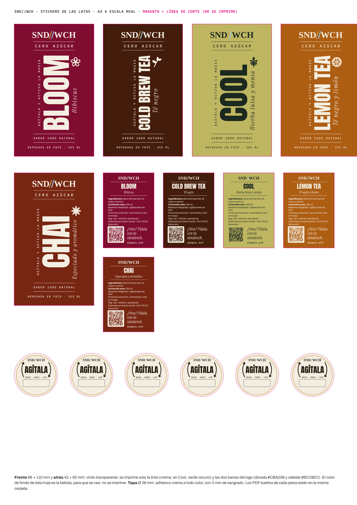

# Las bebidas de SND//WCH, en un solo lugar

Dueño, 2026-11-02: «Guarda los diseños de etiquetas, etc. y guárdalo en el repo a detalle todo sobre las bebidas».

Esta carpeta junta lo que hay que saber de las bebidas para producir, imprimir y mostrar. **No incluye las fórmulas.**
El repo es público y una bebida que se vende en tiendas tiene que proteger su receta (ver «Lo privado», al final).
El análisis completo (latas, selladora, registro sanitario, impuestos, costos, inocuidad) sigue en
[`docs/BEBIDAS_PRODUCTO.md`](../../BEBIDAS_PRODUCTO.md). Las secciones citadas (§) son de ese archivo.

## Dónde estamos (2026-11-02)

- **Al abrir: tres bebidas en botella**, en la web, con sus precios de la base (`catalog_prices`):

  | bebida | precio |
  |---|---|
  | The Bloom | S/6 |
  | Cold Brew Tea | S/5 |
  | The Cool | S/6 |

  - La app dice 355 ml (`BEBIDA_ML`, dueño: «355 ml, como la lata»).
  - Sin sándwich, el pedido pasa desde 2 bebidas (P60).
- **Después, las latas: las cinco**, a S/8. Entran cuando estén la selladora, los stickers, el laboratorio y DIGESA (§26).
  Dueño, 2026-10-24: «Botella al abrir, latas después».
- **En Instagram** las latas salen con «Próximamente»: una pieza aparte, para borrarla cuando se vendan (2026-11-01).

## Las cinco

| id | en la app | en la lata | línea de sabor | ícono | color de la bebida* | tinta | cuándo |
|---|---|---|---|---|---|---|---|
| D06 | The Bloom // Hibiscus | **BLOOM** | *Hibiscus* | flor | `#7F0D31` | crema | al abrir (botella) |
| D07 | Cold Brew // Tea | **COLD BREW TEA** | *Té negro* | brote | `#441C0B` | crema | al abrir (botella), a prueba 4 semanas (§19) |
| D08 | The Cool // Mint | **COOL** | *Hierba luisa y menta* | rama | `#BFB662` | verde oscuro `#1C2920` | al abrir (botella) |
| — | — | **LEMON TEA** | *Té negro y limón* | rodaja de limón | `#AD5E13` | crema | con las latas |
| — | — | **CHAI** | *Especiado y aromático* | anís estrellado | `#772612` | crema | con las latas |

\* El color sale de la lata en alta (la bebida vista a través de la lata transparente), a la altura del fondo. Sirve para las
vistas y las piezas, no se imprime.

**Cómo se eligieron los nombres:**
- Dueño, 2026-10-24: «Los de la app se mantienen; cambian solo los que no tienen nombre» y «El chai debe llamarse Chai
  (pero mejorado), porque vende, es conocida». Lemon Tea y The Chai los eligió entre tres opciones cada uno.
- The Midnight pasó a **Cold Brew Tea** (§19). Se mide a las 4 semanas: sale si no llega al 14% de las bebidas vendidas.
- Dueño: «Jamaica debe ponerse como hibiscus, mejor». El frente dice «Hibiscus» y los ingredientes, «flor de jamaica
  (hibiscus)» (§22).

## El envase

- **Lata PET sleek de 355 ml (55 × 155 mm)**, transparente, con tapa de aluminio. No se imprime sobre la lata: todo va
  en sticker (§15).
- **El color de la lata es la bebida.** Por eso el sticker es transparente y va impreso en crema, y en The Cool, que es
  clara, en verde oscuro.
- Selladora, cotizaciones y si aguanta gas: §14, §16 y §20. La decisión de compra es del dueño (P58).

## Los stickers

Los diseños para la imprenta están en [`etiquetas/`](etiquetas/). Los genera `scripts/piezas/etiquetas-latas.mjs`.



| pieza | medida | material | tinta | archivo |
|---|---|---|---|---|
| **Frente** | 66 × 110 mm | vinilo transparente | crema (Cool: verde oscuro) + las barras dorada y celeste del logo | `frente-<bebida>.pdf` |
| **Atrás** | 42 × 62 mm | vinilo transparente | la misma del frente | `atras-<bebida>.pdf` |
| **Tapa** | Ø 36 mm (+3 mm de sangrado) | adhesivo crema, a todo color | marrón `#241C10`, aro dorado | `tapa.pdf` |
| Hoja para ver y cotizar | A3, a escala real | — | — | `hoja-a3.pdf` |

- **Los PDF sueltos son vectoriales y miden lo exacto.** Son los que van a la imprenta.
  - El frente y el atrás no tienen fondo, porque el vinilo es transparente.
  - Los PNG muestran cada sticker sobre el color de su bebida, solo para verlos.
  - La hoja A3 lleva las vistas en imagen y la línea de corte en magenta, que no se imprime.
- **Tintas:** crema `#F4EEE2`, verde oscuro `#1C2920`, dorado `#CBA258` y celeste `#8CC8EC`. Las dos barras del `//` son
  iguales y paralelas: la izquierda dorada (SANDO) y la derecha celeste (WICHO), como en CLAUDE.md, regla 10.
- **Cotizar en Trujillo** (P67): el frente de 66 × 110 en vinilo transparente, el de atrás de 42 × 62 y el sello de 36 mm.
  Más una etiquetadora de precios de 2 líneas para la fecha y el lote.

### El frente, medida por medida

Medido sobre la lata aprobada de Cold Brew Tea en alta, a 19 px por mm. El borde de arriba del sticker queda a la altura
y = 252 de la imagen. Las medidas van en mm, desde el borde de arriba, y el centro es x = 33.

| elemento | letra | posición |
|---|---|---|
| SND//WCH | Bodoni Moda 700, mayúscula de 4.8 | línea base en 11.4; las barras miden .10em × .88em, separadas .16em, a −16° |
| línea | 0.18 de grosor, de 15.8 a 50.2 | 14.55 |
| CERO AZÚCAR | IBM Plex Mono 500, mayúscula de 2.2, ancho 31.4 | base en 19.3 |
| línea | | 21.66 |
| AGÍTALA Y ACTIVA LA MAGIA | Plex Mono 500 de 2.37, largo 55.1, girada | centrada en 57.2 |
| EL NOMBRE | Anton, largo máximo 62, mayúscula máxima 22.4, girado | centrado en 57.1 |
| la línea de sabor | Instrument Serif cursiva de 5.32, espaciado .12em; se achica si pasa de 49.2 de largo | centrada en 63.7 |
| el ícono | 8.7 × 8.7, trazo de línea | a la derecha del nombre, arriba, centrado en 31.5 |
| línea | | 91.3 |
| SABOR 100% NATURAL | Plex Mono 500, mayúscula de 1.6, ancho 34.3 | base en 95.7 |
| línea | | 98.4 |
| REPOSADA EN FRÍO · 355 ML | Plex Mono 500, mayúscula de 1.5, ancho 43.5 | base en 103.3 |

- **Las tres columnas del medio** (la frase en mono, el nombre y el sabor) van separadas 2.5 y 2.16 mm, y el bloque se
  centra en x = 35.4.
- **El nombre llena el largo de 62 mm** salvo que la letra pase de 22.4 de alto (COOL y CHAI). Siempre va centrado a la
  misma altura.
- Los textos giran 90° y se leen de abajo hacia arriba.

### Atrás

1. La marca, el nombre y el sabor.
2. **Lo legal**, que pide DIGESA (§2, punto 4):
   - ingredientes;
   - contenido neto: 355 ml;
   - «Mantener refrigerado» y «Agítala antes de abrir»;
   - «Fecha de producción, vencimiento y lote: en la tapa»;
   - el registro sanitario y quién lo elabora: razón social, RUC y dirección.
3. **El QR a `sndwch.app/?src=lata`** junto a «¿Otra? Pídela con tu sándwich.» (§22). En crema, el QR va calado en una
   placa para que se lea; en The Cool, impreso en oscuro.

**Lo que falta no se inventa.** Va entre corchetes hasta que el dueño lo dé (P65):
- razón social, RUC, dirección y número de registro;
- los ingredientes de la fórmula final, de mayor a menor peso.

Se llenan en `LEGAL`, al principio del script, y se vuelve a correr.

**Revisar antes de imprimir:**
- **The Chai lleva «Sabor 100% natural»** solo si la caja de los filtrantes no dice «saborizante» ni «aroma» (§17).
- **No se dice «100% ingredientes naturales»**: la sucralosa es sintética y el brillo lleva dióxido de titanio (§17).

### La tapa

- **«AGÍTALA» al centro**, con dos flechas curvas en sentidos opuestos (el gesto de agitar) y la marca arriba.
- **Abajo, el recuadro para la etiquetadora**, con «HECHA · VENCE · LOTE» encima (§21, §22).

## Lo que dice la lata, y por qué

| frase | por qué es cierta | por qué vende | § |
|---|---|---|---|
| **Cero azúcar** | la fórmula no lleva azúcar | el 70% se preocupa por el octógono «Alto en azúcar» (Ipsos Perú, 2025) | 15, 17 |
| **Sabor 100% natural** | el sabor sale de flores, hojas, frutas y especias, sin esencias | una frase concreta es más creíble (Darley y Smith, 1993); el 42% desconfía de lo «saludable» (Kantar, 2025) | 17 |
| **Reposada en frío** | es el proceso | contar el esfuerzo sube la calidad percibida (Kruger, 2004) | 17 |
| **Agítala y activa la magia** | el brillo se asienta y el remolino aparece al agitar | el ritual sube el sabor percibido (Vohs et al., 2013) y es el video que la gente graba | 15 |
| **El nombre enorme, en vertical** | — | se reconoce sin leer, en la góndola y en el feed (tendencia 2026) | 15 |
| **La lata transparente** | — | el color se ve de lejos y sube el apetito (Deng y Srinivasan, 2013; Spence, 2019) | 15 |

- «Cero azúcar» arriba, entre dos líneas finas: el dueño eligió esa forma. Dueño, 2026-10-24: «No me gusta el sticker que
  dice cero azúcar; me gusta que lo diga, pero no el diseño».
- Las frases van en positivo. Dueño: «No menciones cosas negativas», «cero azúcar no es un dato peor».

## Las imágenes

| qué | dónde |
|---|---|
| **Las cinco latas en alta** (1042 × 2785, fondo transparente), sobre la foto real de la lata | `docs/marketing/instagram-perfil/final/latas/lata-*.png` |
| Las cinco juntas | `docs/marketing/instagram-perfil/final/latas/las-cinco.jpg` |
| Cómo se hicieron Lemon Tea y The Chai | `docs/marketing/instagram-perfil/final/latas/hacer-lemon-chai.py` |
| El carrusel y las historias de Instagram, con «Próximamente» aparte | `docs/marketing/instagram-perfil/final/` (`bebidas.cjs`) |
| Las fotos que muestra hoy la web | `img/drink_d06.jpg`, `img/drink_d07.jpg`, `img/drink_d08.jpg` |

**Reglas de imagen:**
- **Siempre en su envase.** Dueño, 2026-10-29: «Debe ser en los envases, nunca en jarra. En el [envase] PET sleek».
- **Nuestra bebida en una foto se compone desde su lata real, nunca se genera** (aprendizajes del director de arte).

**Las fotos de la web están mal hoy.** Muestran la bebida en vaso, en jarra y en frasco, y al abrir llega en botella.
Hace falta una foto real de cada botella con su sticker. La espera el dueño.

## Pendiente (en `docs/PENDIENTE_DEL_DUENO.md`)

| # | qué |
|---|---|
| P64 | La cata de las fórmulas: dosis de sucralosa, pasteurizada contra cruda |
| P65 | Los datos del sticker de atrás y la caja de los filtrantes del chai |
| P66 | El laboratorio: microbiología, azúcares y tabla nutricional |
| P67 | Cotizar los stickers y la etiquetadora |
| P58, P60, P62 | La selladora, DIGESA y el contador |
| — | La foto real de cada botella para la web |

## Lo privado (no va en este repo)

- **Las fórmulas mejoradas se entregaron aparte, en el chat:**
  - la v5, el 21 de octubre;
  - la v6, con el Lemon Tea al estilo Arnold Palmer y la ejecución al milímetro, el 24.

  Viven fuera del repo y el dueño las guarda.
- **Ojo:** el recetario de producción de hoy (`RECETARIO.md`, con sándwiches, salsas y la receta vieja de las bebidas en la
  PARTE 4) y `modelo/costo_bebidas.py` **están en este repo, que es público**. Sacarlos es decisión del dueño. Borrarlos
  del historial es git destructivo y necesita su sí expreso.

## Cómo se vuelve a generar

```bash
npm install --no-save qrcode@1.5.4
FUENTES_CSS=$(bash scripts/piezas/fuentes-locales.sh) node scripts/piezas/etiquetas-latas.mjs                     # stickers
FUENTES_CSS=$(bash scripts/piezas/fuentes-locales.sh) python3 docs/marketing/instagram-perfil/final/latas/hacer-lemon-chai.py   # latas nuevas
```
