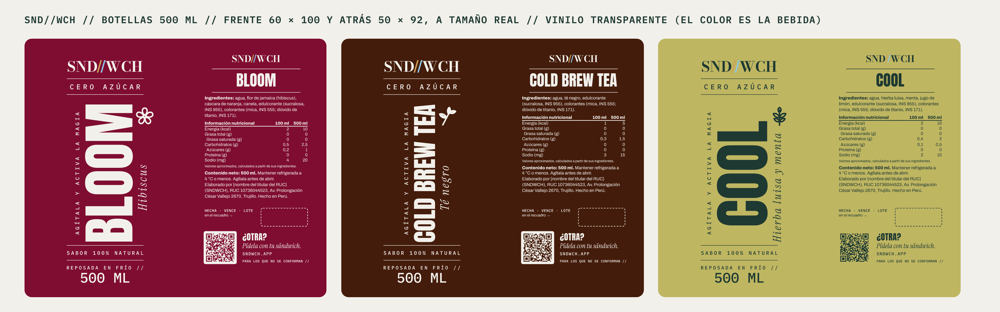

# Stickers para abrir el 20 de noviembre (2026-11-09)

Dueño, 2026-11-09: «También necesito que me mandes todos los stickers que necesito». Los genera
`scripts/piezas/stickers-apertura.mjs`. Los PDF de imprenta, con el nombre del titular, están en
`/mnt/project-files/stickers-apertura/` (aquí van con `[nombre del titular del RUC]`: el repo es público).

## La lista

| # | sticker | archivo | medida | material | cuántos para abrir | precio de referencia |
|---|---|---|---|---|---|---|
| 1 | **Cierre de la bolsa con QR** (ya aprobado) | `../imprimir/sticker-bolsa-7x7cm.pdf` | 7 × 7 cm, precorte a 1.1 cm | papel adhesivo **mate** | **250** | S/60 las 250 (lista Host4Plus) |
| 2 | **Botella, frente** (BLOOM, COLD BREW TEA, COOL) | `botella-frente-<sabor>.pdf` | 60 × 100 mm | vinilo **transparente**, tinta blanca de base en BLOOM y COLD BREW TEA | **24 de cada sabor** (3 planchas A3) | pedir precio por plancha |
| 3 | **Botella, atrás** (uno por sabor, con su QR) | `botella-atras-<sabor>.pdf` | 50 × 92 mm | igual que el frente | **24 de cada sabor** (en la misma plancha) | va con el frente |
| 4 | **Salsas y soluciones**, con nombre | `salsas-A4-1-con-nombre.pdf` | 60 × 40 mm, 18 por A4 | vinilo **blanco + laminado mate** | **1 plancha A4** (18) | pedir precio |
| 5 | **Salsas en blanco** (repuestos y lo nuevo) | `salsas-A4-2-en-blanco.pdf` | 60 × 40 mm, 18 por A4 | igual | **1 plancha A4** (18) | pedir precio |
| 6 | Calle (opcional, publicidad) | `../imprimir/sticker-calle-8x8cm.pdf` | 8 × 8 cm | vinilo blanco + laminado mate UV | 0 por ahora (o 250) | S/70 las 250 en papel; vinilo, aparte |

**No necesitan sticker:** el papel manteca (ya tienes el que lleva logo), las latas (hasta que se
compre la selladora; la etiqueta v3 está lista en `/mnt/project-files/latas/imprenta-v3/`) y las
porciones en bolsitas de congelar (cinta masking y plumón: producto y fecha, es lo más barato).

## Por qué así

- **Botella.** Al abrir las bebidas van en la botella de 500 ml (OPERATIVO.md). Es el mismo diseño de
  la lata v3: transparente, el color lo pone la bebida, «500 ML» con cifras de 4 mm en el frente (de
  200 a 1000 ml, la cifra mide 4 mm o más), la tabla por 100 ml y por botella, y un QR por sabor
  (`?src=botella-bloom`, etc.): cuenta cuántos piden otra desde la botella. Las fechas se escriben a
  mano en el recuadro de atrás.
- **24 de cada sabor para empezar**, no las 200: todavía no se sabe qué sabor sale más. En una
  plancha A3 (297 × 420) entran 8 juegos (frente + atrás). Se reimprime lo que se acabe.
- **Salsas.** Se escriben con **plumón indeleble** y se borran con alcohol: la etiqueta se reusa en
  cada tanda (frascos.md: «todo con etiqueta: código, fecha y vence»). El código es el de la carta.
  Los 9 squeeze y 11 frascos de `frascos.md` quedan cubiertos, con 2 de sobra y la plancha en blanco.
- La **línea fucsia** del pliego de salsas es solo la guía de corte: no se imprime.

## Antes de imprimir

1. **Mide la parte lisa de la botella** (alto, sin el cuello ni la base). La etiqueta de 100 mm entra
   si mide 10.5 cm o más. Si es menos, se ajusta.
2. **Tinta blanca:** el texto crema sobre vinilo transparente (BLOOM y COLD BREW TEA) necesita
   blanco de base. Si la imprenta no tiene blanco, el texto sale muy claro: avísame y lo paso a verde.
3. **La sal:** la etiqueta de la botella dice que no lleva sal, como dijiste; en la receta guardada
   cada litro lleva 2 g de solución de sal al 10% (0.2 g de sal). Por eso hay una etiqueta «SAL AL
   10%». Si no lleva, se quita; si sí lleva, se agrega a los ingredientes de la botella.

## Dónde imprimir en Trujillo

No encontré imprentas de Trujillo con precios publicados en internet, así que no recomiendo ninguna
sin verla. Lo que hay que pedir, tal cual:

- Bolsa: «250 stickers troquelados de 7 × 7 cm en papel adhesivo mate, con precorte».
- Botellas: «planchas A3 de vinilo transparente, impresión con tinta blanca y corte de contorno».
- Salsas: «2 planchas A4 de vinilo blanco con laminado mate y corte de contorno».

Usa la lista de Host4Plus (Supersiro SAC) de `docs/marketing/stickers/README.md` como tope: si en
Trujillo cobran más, conviene pedírselo a ellos.
